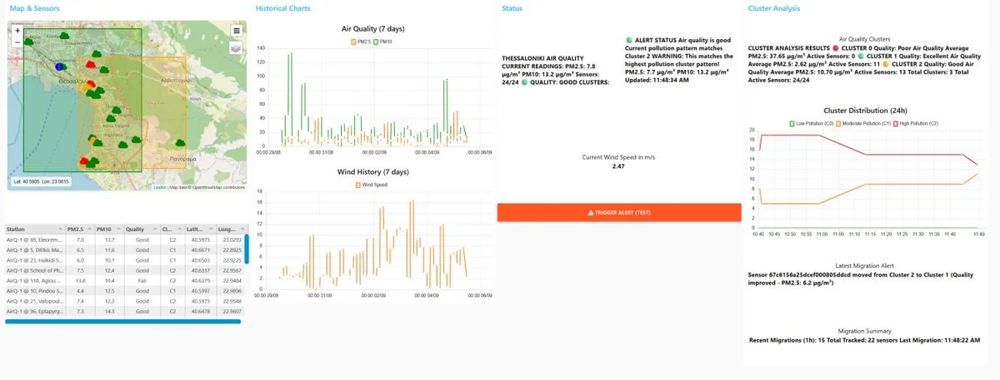
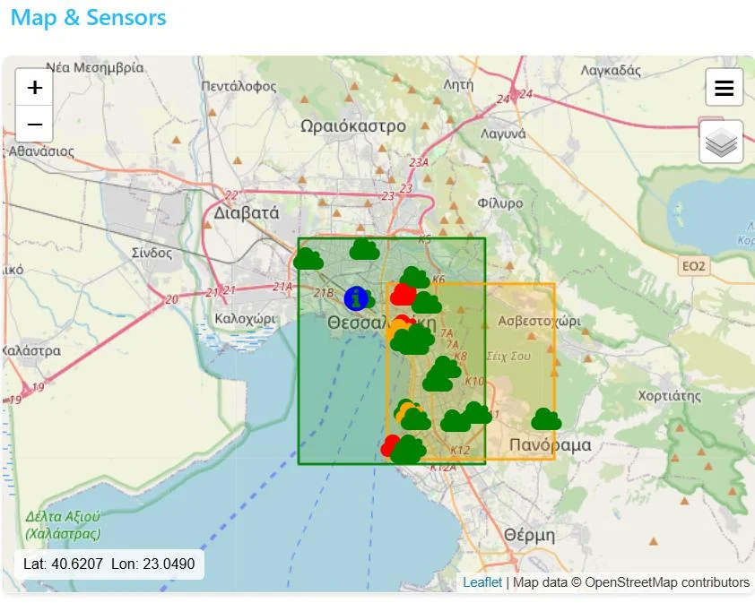
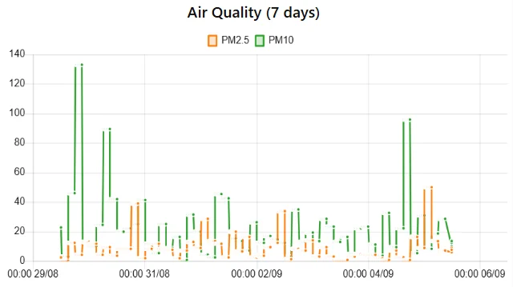
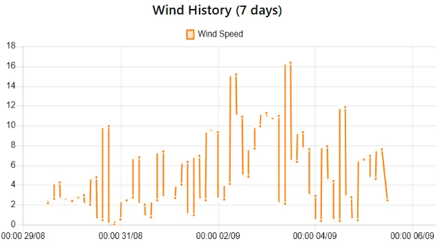
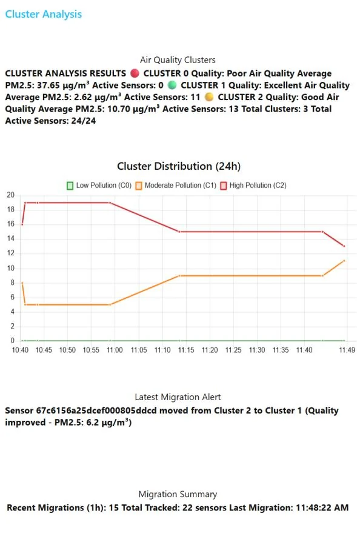
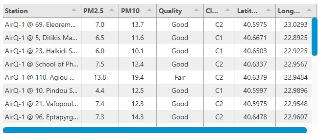
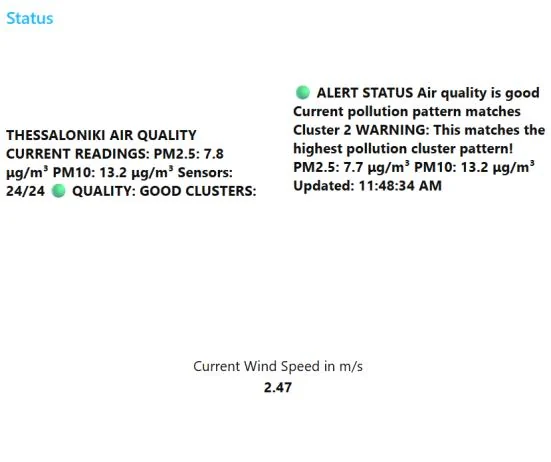
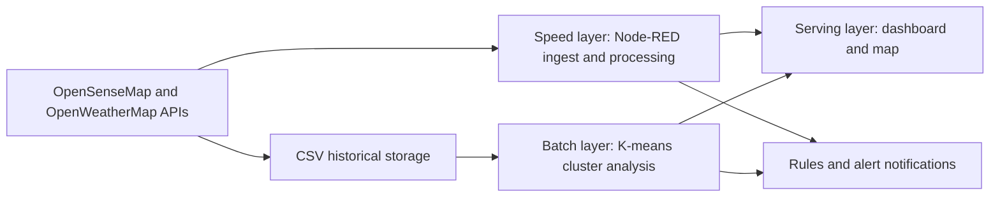

# Thessaloniki Air Quality Monitoring

**Node-RED · Lambda-style Architecture · Environmental Data · Smart City**

An academic prototype for monitoring air-quality indicators around **Thessaloniki, Greece**. The Node-RED flow combines OpenSenseMap sensor readings and OpenWeatherMap wind data, stores historical CSV records, runs descriptive K-means clustering and exposes a geospatial dashboard with rule-based alerts.

> **Portfolio archive (2025):** Screenshots are taken from the submitted university report. The project was not re-executed or redeployed for this repository. Historical sample data was synthetically generated for the coursework; screenshots are saved outputs, not proof of a currently running service.

## Highlights

| | |
|---|---|
| **Implementation** | 74 Node-RED nodes, including 23 Function nodes |
| **Data** | OpenSenseMap PM2.5/PM10 and OpenWeatherMap wind observations |
| **Processing** | Near-real-time updates, historical CSV processing, descriptive K-means (`k=3`) |
| **Presentation** | Interactive map, time-series charts, sensor table, alerts and cluster changes |
| **Source** | Sanitized importable Node-RED flow + original Python data generators |

## Screenshots from the submitted report

| Sensor map | Historical PM2.5 / PM10 |
|---|---|
|  |  |
| Wind history | Cluster analytics |
|  |  |
| Sensor table | Live status panel |
|  |  |

The figures show the historical dashboard state at submission time, including simulated/test inputs. They do **not** represent current air quality.

## Lambda-style architecture

The coursework models three *conceptual* layers within a Node-RED application:

- **Speed:** periodically fetch readings, parse sensor metadata, classify readings against the current clusters and update in-memory state.
- **Batch:** reload historical CSV records and compute descriptive K-means centroids.
- **Serving:** show the map, tables and plots, report migration events and evaluate alert conditions.

This is a **single-application educational prototype**, not an independently scaled production Lambda deployment.

## Source code and setup

| File | Purpose |
|---|---|
| [`flows/thessaloniki-air-quality-lambda.json`](flows/thessaloniki-air-quality-lambda.json) | Original 74-node flow, with secrets and personal file paths replaced |
| [`scripts/boxesgenerator.py`](scripts/boxesgenerator.py) | Synthetic historical PM2.5 / PM10 readings for the coursework |
| [`scripts/windgenerator.py`](scripts/windgenerator.py) | Synthetic wind-speed history |
| [`data/`](data/) | Small examples of the original generated CSV files |
| [`.env.example`](.env.example) | Configuration placeholders — **never add real credentials to Git** |

### Configuration (if you want to run it yourself)

1. Install Node-RED and import `flows/thessaloniki-air-quality-lambda.json` in the editor.
2. Install the required community nodes for the imported flow, including **Node-RED Dashboard**, **Worldmap**, **UI Table** and **Email** integration where missing. Exact package compatibility depends on your Node-RED version.
3. Supply the environment variables listed in `.env.example` through your Node-RED environment/configuration. In particular, set **your own** OpenWeatherMap API key and local CSV file paths.
4. Configure your own SMTP credentials in Node-RED's credential store if you want email alerts. The repository contains no SMTP password or token.
5. The included Python generators write new, **synthetic** seven-day CSV files in the current working directory; move or reference those files as appropriate. The `data/sample_*.csv` files are small examples, not a complete time-series replay.

> This is an archival reproduction package: **no new runtime verification was performed**. API responses, installed Node-RED packages and timing assumptions may need adjustments on a current installation.

## Security and reproducibility notes

- The original submission had a hard-coded API key, an email recipient and absolute Windows user paths. These have been replaced in **the published flow** with `${OPENWEATHERMAP_API_KEY}`, `ALERT_EMAIL_TO`, `THESS_WIND_CSV_PATH` and `THESS_BOXES_CSV_PATH` configuration.
- The original PDF is intentionally **not published**, because its appendix contained the old credential. The images here were extracted separately and omit personal-email screenshots.
- Previously embedded credentials must be considered exposed and **revoked/rotated** if still valid. Substituting a placeholder in this repository does not revoke an old key.
- Sensor identifiers in the public OpenSenseMap API are **identifiers of public observation sources**, not authentication secrets.
- Some historical CSV records were generated synthetically. Do not interpret their pollution patterns as validated environmental measurements or public-health guidance.

## Limitations

The map, clustering, thresholds and alert rules were built to demonstrate multi-source ingestion and Lambda-style processing. The report itself notes that the relatively small sensor sample and short time window limit statistical generalization. All pollutant thresholds are **project configuration choices**, not authoritative health advisories.

## Credits

**Antonis Rouseas** — University assignment, Department of Informatics & Telematics, Harokopio University of Athens (2025).

[GitHub profile](https://github.com/jerrybananas) · [LinkedIn](https://www.linkedin.com/in/antonis-rouseas/)